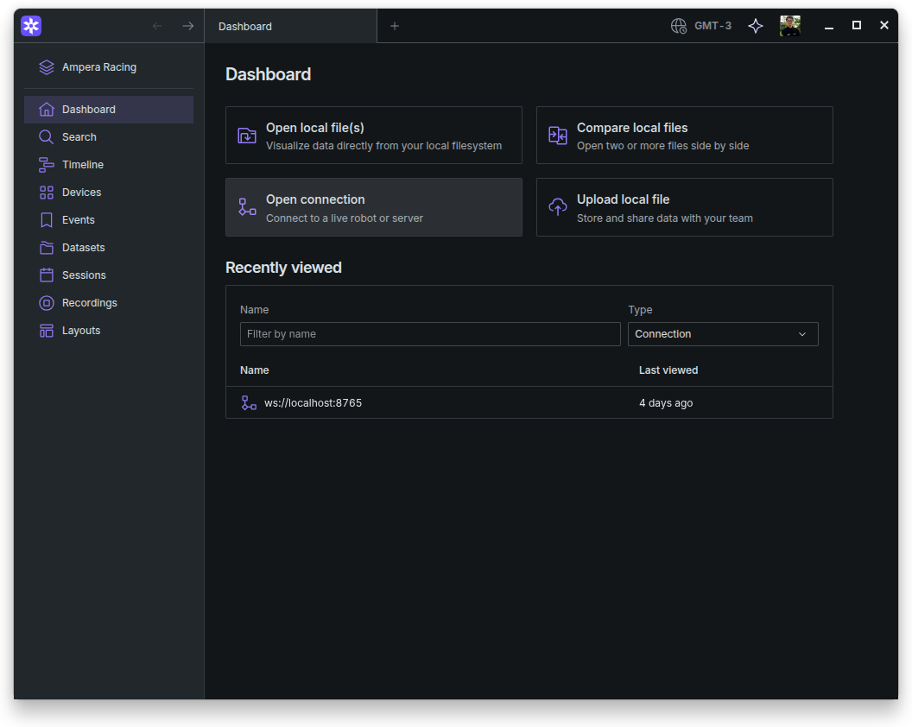
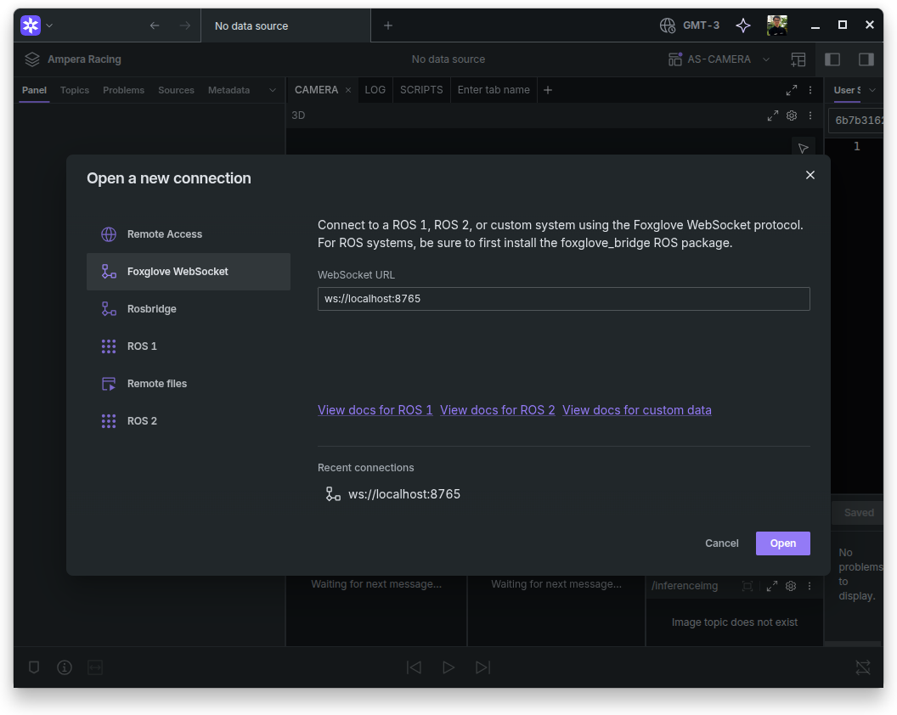
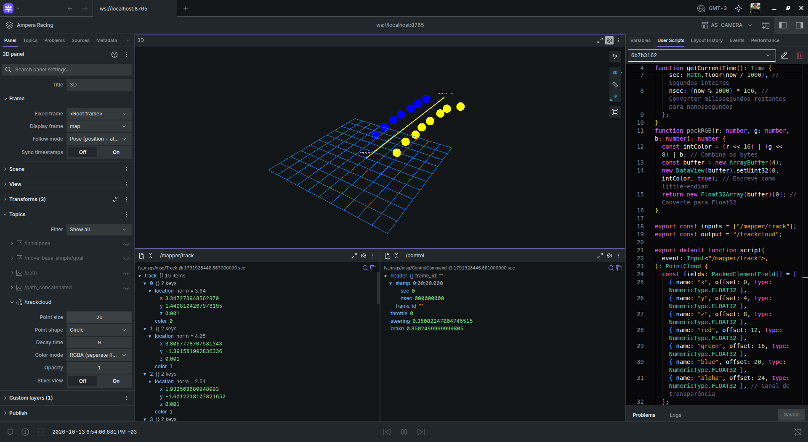

# Foxglove: Quick Start

How to visualise ROS 2 topics and bags in Foxglove Studio.

## Requirements

- Pampas built and set up. You can check on [Build](../build.md) page
- A bag in `mcap` format (see [Record and Play Bags](record-and-play.md))

> If you just need to **visualize** data recorded in a bag, the only ROS package you need is `fs_msgs`. You can build it with:
>
> ```bash
> colcon build --packages-select fs_msgs
> ```

## Installation

### Foxglove Studio

Download the `.deb` from <https://foxglove.dev/download> (pick the package for your system architecture), then run:

```bash
sudo apt install ./foxglove-studio-*.deb
```

### Foxglove ROS 2 bridge

We use ROS 2 Humble:

```bash
sudo apt install ros-humble-foxglove-bridge
```

## Usage

### 1. Terminal 1: run the Foxglove bridge

Go to `pampas/` and source the workspace:

```bash
source install/setup.bash
```

Run the bridge:

```bash
ros2 launch foxglove_bridge foxglove_bridge_launch.xml
```

### 2. Terminal 2: play the bag

Go to `pampas/` and source the workspace:

```bash
source install/setup.bash
```

Play the bag:

```bash
ros2 bag play bag_path/bag.mcap --loop
```

`--loop` keeps the bag playing in a loop, without closing. See [Record and Play Bags](record-and-play.md) for more details.

### 3. Connect Foxglove Studio

1. Open Foxglove Studio and click the `Open connection` button.

    

2. Click the `Open` button.

    

## Result

You should now see all topics and the different panels.


