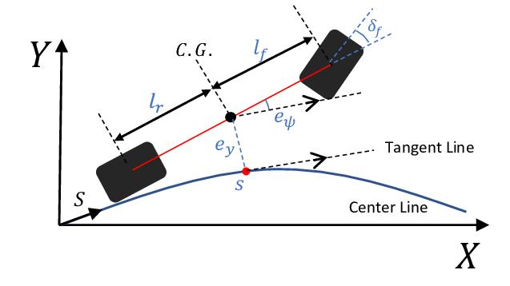

# Control

In Driverless, we divide the control system into several modules, including:

- Lateral Control
- Longitudinal Control
- Low-Level Lateral Control

In this article, we will focus on the **Lateral Control** problem and its interactions with the preceding and following modules, namely **Path Planning** and **Low-Level Control**, respectively.

Since 2021, we have been using the KLS controller (Kinematic Lateral Steering) in Driverless. It was first introduced in the paper *Path Planning and Guidance Laws of a Formula Student Driverless Car*, published by researchers from the University of Lisbon.

The main idea behind this controller is to go beyond simply correcting the vehicle's positional error. Instead, KLS calculates the desired lateral velocity required to reach a given trajectory.

## KLS

For example:

- If the vehicle is slightly off the trajectory, a small correction may be sufficient.
- If the vehicle is far away from its intended trajectory, a higher lateral velocity may be necessary.
- If the vehicle is approaching its intended trajectory, the control signal must gradually decrease to prevent overshooting.

Before implementing the controller, we must first define its variables, followed by the node's subscribers and publishers.

### Controller Variables

| Variable | Meaning | Explanation |
|---|---|---|
| \(e_y\) | Vehicle lateral error | Difference between the vehicle's actual position and its intended position along the trajectory. |
| \(e $\psi$) | Heading error | Difference between the vehicle's forward direction and the tangent to the intended trajectory at the vehicle's reference position. |
| \(v_x\) | Longitudinal velocity | Vehicle velocity along its longitudinal axis. |
| \(v_y\) | Lateral velocity | Vehicle velocity along its lateral axis. |
| \($\delta$) | Steering angle | Steering angle commanded by the controller. |
| \(L\) | Vehicle wheelbase | Distance between the front and rear axles. |

### ROS Control Package – Inputs and Outputs

| Sub/Pub | KLS Variable | Explanation |
|---|---|---|
| Path | `reference_trajectory` | List of points used to calculate the desired position and orientation. |
| Odometry | `measured_state` | Most recently published vehicle position and linear velocities. |
|---|---|---|
| ControlCommand | `steering_angle` | \($\delta$) |
| Speed | `x_velocity`, `y_velocity` | \(v_x\) (velocity magnitude) |
| — | `eh` | \(e $\psi$) (Heading error) |
| — | `ey` | \(e_y\) (Vehicle lateral error) |

## KLS Equation

$$
\LARGE
\delta_{cmd} = \arctan \left(
L \left(
- K_{\psi}^{KLS} \sin(e_{\psi})
- \frac{K_{\psi}^{KLS} K_{e_y}^{KLS} e_y}{v_x}
+ \frac{k_{RP}\cos(e_{\psi})}{1-k_{RP}e_y}
\right)
\right)
$$

### First Term

$$
\large
- K_{\psi}^{KLS} \sin(e_{\psi})
$$

The first term corrects the angular difference between the vehicle's heading and the desired trajectory.

### Second Term

$$
\large
- \frac{K_{\psi}^{KLS} K_{e_y}^{KLS} e_y}{v_x}
$$

The second term corrects the vehicle's lateral displacement. It depends on \(v_x\), meaning that the same lateral position error requires a different correction depending on the vehicle's velocity magnitude.

### Third Term

$$
\large
+ \frac{k_{RP}\cos(e_{\psi})}{1-k_{RP}e_y}
$$

Our vehicle has physical limitations: it cannot instantly perform a 90-degree turn. This is why the third term is particularly important.

It accounts for the curvature of the reference trajectory, with \(K_rp\) representing an approximation of the curvature at the closest point on the reference trajectory.